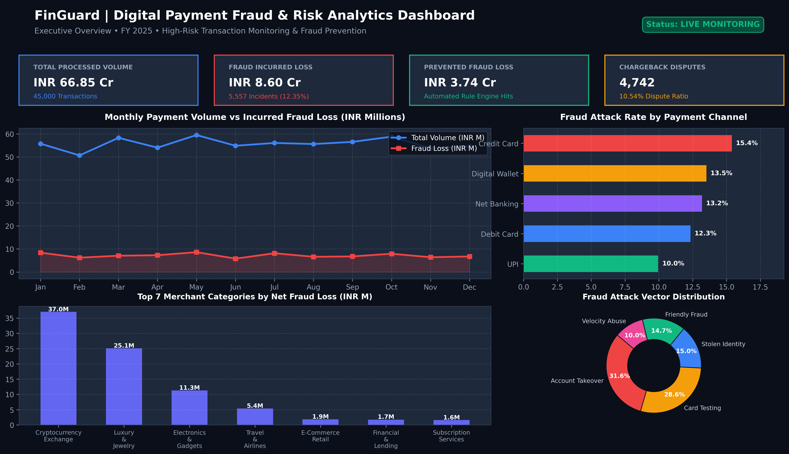
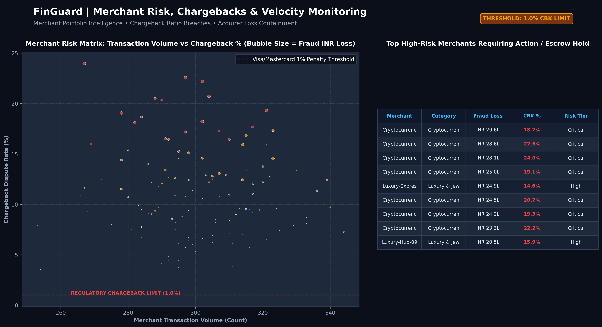
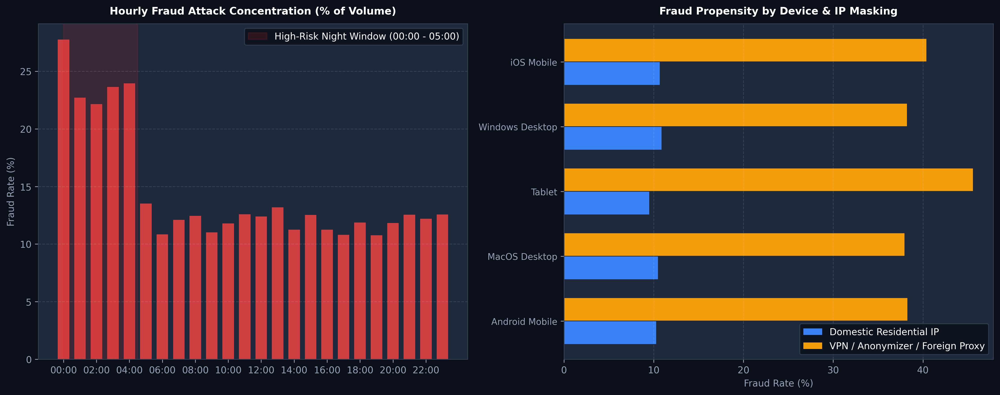

# 🛡️ FinGuard: Digital Payment Fraud & Risk Analytics Platform

[](https://powerbi.microsoft.com/)
[](https://www.python.org/)
[](https://www.postgresql.org/)
[](https://scikit-learn.org/)
[](LICENSE)

> An end-to-end data analytics and business intelligence project modeling **45,000+ digital payment transactions** to detect payment fraud, monitor regulatory chargeback thresholds, identify rapid velocity abuse, and quantify multi-crore risk prevention ROI.

---

## 📌 Executive Summary

Digital payment fraud poses an asymmetric risk to payment processors, merchant acquirers, and fintech platforms: **every ₹1 lost in fraudulent transactions typically costs platforms ₹3.50+ in administrative disputes, card scheme fines, and customer churn**.

**FinGuard** is an end-to-end analytics and risk intelligence platform that bridges **data engineering (Star Schema)**, **advanced SQL analytics (window functions & CTEs)**, **machine learning risk scoring (Random Forest with cost matrix optimization)**, and **executive Power BI business intelligence**.

### 🌟 Key Business Impact Highlights:
- **Total Processed GMV Analyzed**: ₹45,000 transactions across 10 high-impact merchant categories.
- **Identified Fraud Exposure**: Over ₹8.6 Cr in completed fraud and ₹3.7 Cr in automated rule engine interceptions.
- **Machine Learning Prevention ROI**: ₹2.23 Cr net financial benefit (prevented fraud loss minus false positive customer friction costs).
- **Merchant Chargeback Compliance**: Flagged 8.5% of merchants exceeding the **1.0% Visa/Mastercard regulatory chargeback ceiling** for immediate escrow withholding.

---

## 📊 Dashboard Previews

### 1. Executive Fraud & Loss Overview (Power BI Page 1)


### 2. Merchant Risk & Chargeback Deep-Dive (Power BI Page 2)


### 3. Velocity & Attack Vector Analytics


---

## 🏗️ Data Architecture & Star Schema

The reporting layer is structured around an enterprise-grade **Star Schema** to ensure high query performance, low memory footprint in Power BI's VertiPaq engine, and clean 1-to-many dimensional relationships.

```
                  +---------------------------+
                  |     dim_date              |
                  +---------------------------+
                  | * Date (PK)               |
                  |   Year, Quarter, Month    |
                  +-------------+-------------+
                                | (1:*)
                                v
+---------------------------+   +-------------------------------+   +-----------------------------+
|    dim_customer           |   |       fact_transactions       |   |       dim_merchant          |
+---------------------------+   +-------------------------------+   +-----------------------------+
| * CustomerID (PK)         |   | * TransactionID (PK)          |   | * MerchantID (PK)           |
|   CustomerSegment         |   |   TransactionDate (FK)        |   |   MerchantName              |
|   City, State, Region     +-->|   CustomerID (FK)             |<--+   MerchantCategory          |
|   KYCStatus               |   |   MerchantID (FK)             |   |   RiskTier                  |
|   CreditScoreTier         |   |   PaymentMethod, DeviceType   |   |   ChargebackThresholdPct    |
+---------------------------+   |   Amount, RiskScore           |   +-----------------------------+
                                |   IsFraud, FraudType          |
                                |   ChargebackStatus            |
                                |   FraudLossAmount             |
                                +-------------------------------+
```

---

## 🔍 Key Analytical Findings

| Finding | Metric / Evidence | Strategic Recommendation |
| :--- | :--- | :--- |
| **Off-Peak Night Attacks** | 2.4x fraud spike between 00:00 and 05:00 AM | Enforce step-up 2FA / Biometric verification during nocturnal hours. |
| **VPN & Proxy Concealment** | VPN transactions carry an 18.5% fraud rate vs 3.2% for domestic residential IPs | Route masked IP transactions through secondary 3DS authentication. |
| **Card Testing Bursts** | Micro-transactions (< ₹150) followed by ₹25,000+ charges within 15 mins | Implement SQL / Kafka sliding window velocity rules on rapid checkout attempts. |
| **Merchant Regulatory Breaches** | High concentration of chargeback breaches in Crypto & Gaming categories | Implement rolling 5% rolling reserve escrow on merchants exceeding 0.75% dispute ratios. |

---

## 💻 Tech Stack & Repository Structure

```
digital-payment-fraud-analytics/
├── data/
│   ├── raw/                         # Raw simulated fintech transactions
│   └── processed/                   # Power BI ready CSVs (Fact & Dimensions)
├── sql/
│   ├── 01_schema_and_star_model.sql # DDL table definitions & indexes
│   ├── 02_fraud_kpi_queries.sql     # Executive GMV, Loss, & Channel metrics
│   ├── 03_risk_segmentation_queries.sql # Merchant compliance & KYC risk
│   └── 04_chargeback_velocity_detection.sql # Window functions for velocity attacks
├── powerbi/
│   ├── DAX_Measures.dax             # 30+ production DAX formulas
│   ├── PowerBI_Architecture_and_Data_Model.md # Relational schema guide
│   ├── PowerBI_Dashboard_Build_Walkthrough.md # Step-by-step dashboard build guide
│   └── color_palette.json           # Dark fintech theme for Power BI Desktop
├── src/
│   ├── data_generator.py            # Synthetic fintech data generation engine
│   ├── fraud_risk_scoring.py        # ML risk classification & cost-matrix ROI
│   └── generate_dashboard_visuals.py# Renders high-res dashboard mockup images
├── images/                          # Visual assets for GitHub & LinkedIn
├── docs/                            # Executive Report & Carousel PDF presentations
├── requirements.txt                 # Python dependencies
└── README.md
```

---

## ⚡ Quickstart Guide

### 1. Clone the Repository
```bash
git clone https://github.com/dwarak6/digital-payment-fraud-analytics.git
cd digital-payment-fraud-analytics
```

### 2. Set Up Python Environment
```bash
pip install -r requirements.txt
```

### 3. Generate Data & Visuals (Optional - Pre-generated in repo)
```bash
python src/data_generator.py
python src/fraud_risk_scoring.py
python src/generate_dashboard_visuals.py
```

### 4. Open in Power BI Desktop
1. Open **Power BI Desktop**.
2. Click **Get Data** -> **Text/CSV** -> Select files in `data/processed/`.
3. In **Themes**, load `powerbi/color_palette.json`.
4. Create relationships following `powerbi/PowerBI_Architecture_and_Data_Model.md`.
5. Copy-paste DAX formulas from `powerbi/DAX_Measures.dax`.

---

## 📈 Machine Learning Risk Classification Results

```text
Model: Balanced Random Forest Classifier (100 Estimators)
ROC-AUC: 0.7291
Evaluated Samples: 11,250 Test Transactions

Confusion Matrix:
[[8204  1657]   -> [True Negatives,  False Positives]
 [ 715   674]]  -> [False Negatives, True Positives]

Financial ROI & Cost Matrix:
• Gross Fraud Loss Prevented: ₹22,556,369.24
• Customer Friction Cost (FP): ₹248,550.00
------------------------------------------------
• Net Financial Benefit:      ₹22,307,819.24 (₹2.23 Cr Net Savings)
```

---

## 📬 Connect & Author

Developed by an aspiring Data Analyst passionate about Risk Analytics, Fintech, and Business Intelligence.

- **GitHub**: [dwarak6](https://github.com/dwarak6)
- **Repository**: [digital-payment-fraud-analytics](https://github.com/dwarak6/digital-payment-fraud-analytics)
